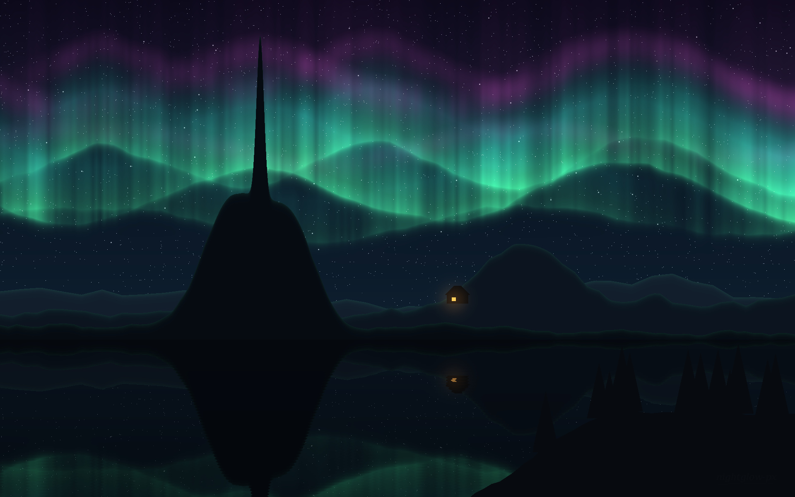

# aurora-gen

Night skies from noise and a handful of sine waves.



*Northern Light*, 2026. Rendered at 1920×1200.

## What it does

`aurora.py` builds a landscape in layers, back to front:

1. a sky gradient with a few thousand stars
2. three aurora curtains: a sharp lower edge, a long fade upward, and vertical rays from 1D noise
3. mountain ridges from fractal noise, plus a couple of hand-placed peaks
4. a lake that mirrors everything above the shoreline, darkened and rippled

Every run with the same seed gives the same picture. Change the seed for a new sky.

```bash
pip install numpy pillow
python aurora.py --seed 7 --out sky.png
```

## Where else to find me

I don't post the prints here. They hang at **Lumen Gallery**, where I show as **`quiet.meridian`**.
